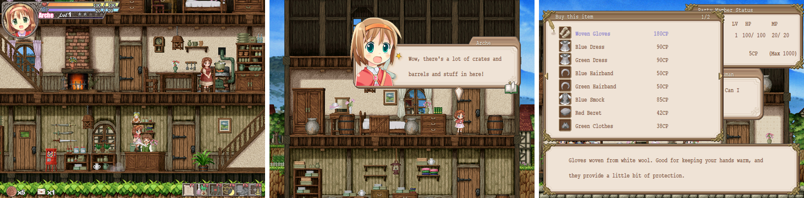
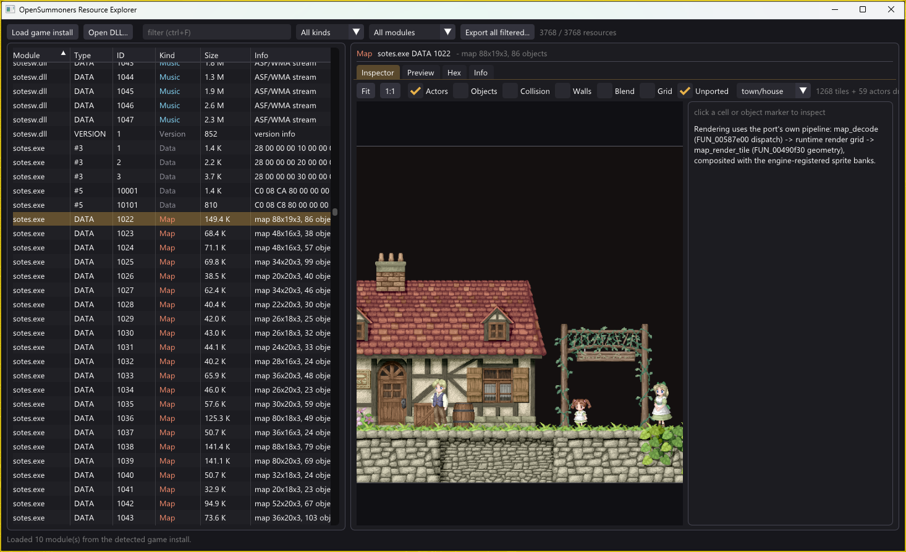
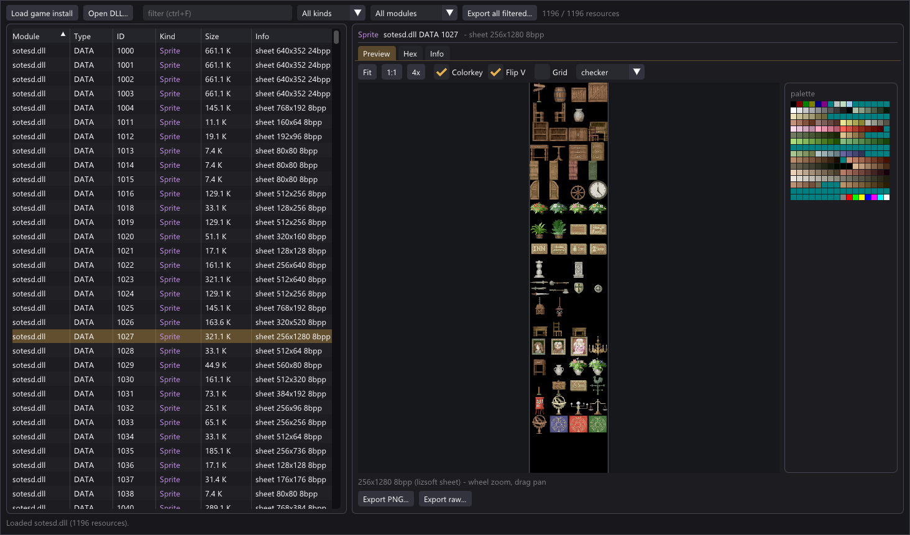
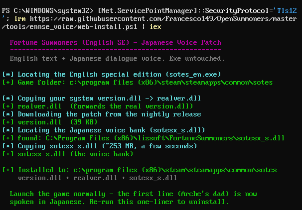

# OpenSummoners

An open-source reimplementation of **Fortune Summoners: Secret of the
Elemental Stone** (Lizsoft, 2008 JP / Carpe Fulgur, 2012 EN Steam release).

This is an **educational reverse-engineering and game-preservation project**.
The goal is a drop-in replacement for `sotes.exe` that behaves
indistinguishably from the original for a user who owns a legitimate copy of
the game.

**Not distributed:** no game assets, no decompiled binary code, no copyrighted
content of any kind.  You supply your own copy of the game (Steam).

## Status (October 2026)

**The whole engine is ported, and the game runs on it with no original code at all.**
`opensummoners-standalone.exe` plays the English 2012 release using only the *data* from
your own `sotes.exe` and its DLLs (strings, tables, maps, sprites, sound). Every
instruction it executes is OpenSummoners' C code. In the recorded playthroughs below, the
port's output matches the original pixel for pixel.

[](docs/media/standalone-frames.png)

*Frames from a recorded play session, rendered by the standalone port. Each is
pixel-identical to the original game at the same frame (`differ_px = 0`).*

- **Verified against the original game** on 10 recorded scenarios of the 2012 edition
  (about 240,000 frames: intro, town and house errands, item finds, combat with a party
  ally, a game over and retry, statue saves, the shop, the main menus, quitting). Every
  presented frame has the same pixels, and each run ends on the same frame, tick count
  and random-number state.
- **Proven not to contain or run original code.** Each run writes an audit (which byte
  ranges were read from your files, that every code byte is a trap, that nothing outside
  the port is executable). `tools/standalone/prove_no_retail_code.py` re-checks the
  binaries and sources independently.
- **Ported:** 1,558 of the 1,824 functions in `sotes.exe` are reimplemented, which is
  100% of the engine's code bytes. The rest are almost all C-runtime internals the game
  never calls directly (the port has its own small C runtime). If a play session ever
  reached original code with no port, the game would stop with a message naming the
  address. None is known.
- **Ported is not the same as verified or documented.** Only code the recorded plays
  actually run is checked against the original. The recordings enter 1,165 of the 1,550
  game functions at least once (63% of the code bytes), and many branches inside those
  never run. The rest (mostly later chapters' event scripts, plus most character and
  monster types, the ending, the bonus menu, gamepad input and the Japanese text paths) is
  translated from the decompilation and compiles, but no recording has exercised it yet.
  Bugs there will surface as those parts get played. Much of the port is also still
  undocumented: more than half of the ported functions are decomp2c's translation, named
  after their address, with structure fields as raw offsets. Full coverage, every
  function exercised, verified and documented, is a long-term goal, and it takes many
  more recorded playthroughs. Each new recording of new content becomes another
  regression gate.
- **Limits:** English 2012 edition only (the 2020 Special Edition comes later). Windows
  only. The C runtime's heap places memory blocks differently from the original (no
  visible effect; tracked in [`docs/port-debt.md`](docs/port-debt.md)). Long-play audio
  hasn't been checked yet.

Details: [`docs/standalone.md`](docs/standalone.md) (how the standalone works, the proof),
[`docs/STATUS.md`](docs/STATUS.md) (current front), [`docs/PROGRESS.md`](docs/PROGRESS.md)
(changelog).

## How the port got done so fast

The first two months (May–July 2026) went the classic way: run the original and the port
side by side and compare screenshots and traces. That reached **233 functions** (boot, the
title, the opening arc) because every mismatch had to be traced back from pixels to code.
The project then switched methods, and **from October 14 to 24 the remaining ~1,300
functions were ported**, with everything the recorded plays reach verified against the
original:

1. **rhost, the original game as a test fixture.** `tools/rhost/` loads your `sotes.exe`
   into our own process and runs it deterministically: virtual clock, scripted keyboard,
   fixed heap, handles and stack. The same input recording gives the same game state,
   bit for bit, at about 1,000 frames per second.
2. **Verify each function in isolation.** Once a function is written in C, rhost runs the
   original and the port on the same game state at every call during a recorded play
   ("shadow" mode) and compares the results. A divergence names the function,
   the call and the field.
3. **Then replace it.** The port takes over from the original (`--hook replace:NAME`) and
   the recorded corpus is replayed. Final game state, RNG, tick count and every presented
   frame's pixels must match the original's.
4. **A mechanical first draft.** `tools/ida/decomp2c.py` turns the IDA decompilation
   (with recovered C++ classes) into compilable C that keeps the original's control flow,
   stack layout and calling conventions. A person reviews and cleans it up, and steps 2–3
   decide whether it's right.
5. **The hybrid, then nothing.** With every ported function replacing the original at
   once, rhost's coverage mode lists whatever original code still runs. That list went to
   zero, and the standalone maps only the data sections of `sotes.exe`: code is filled with
   traps plus jumps into the port.

Method notes: [`CLAUDE.md`](CLAUDE.md) (the loop and gates), [`tools/rhost/`](tools/rhost)
(the host), [`docs/audits/2026-10-14-rhost-methodology.md`](docs/audits/2026-10-14-rhost-methodology.md)
(why the switch).

## Play it (Windows)

You need your own copy of **Fortune Summoners: Secret of the Elemental Stone** (Steam,
2012). The stock Steam `sotes.exe` works as is.

1. Build `opensummoners-standalone.exe` (see *Building* below; not yet in the nightly
   downloads).
2. Copy it into a folder holding `sotes.exe`, `sotesd.dll`, `sotesw.dll`, `sotesp.dll` and
   `lizsoft.spl`, either the Steam install or a copy of it.
3. Run it. The game's own launcher appears as usual. Saves and settings go to that
   folder's `user\`.

Notes: **Zoom Mode** is a borderless window covering the whole desktop (the original
does the same), so it looks like fullscreen. **Fullscreen Mode** needs Windows' 16-bit
color emulation, which the exe applies to itself (without it, the original can fail to
start fullscreen on Windows 11). A log and the run's audit land in
`opensummoners-standalone\`.

## Get the game (support the author)

Fortune Summoners is still on sale — if this project interests you, please buy the
game and support Lizsoft:

- **[Fortune Summoners Special Edition](https://store.steampowered.com/app/1381770/Fortune_Summoners_Special_Edition/)**
  (Steam, 2020) — published by Lizsoft directly; Japanese + English, Windows 10
  fixes. **Recommended**, and the edition the voice patch targets.
- [Fortune Summoners: Secret of the Elemental Stone](https://store.steampowered.com/app/203510/Fortune_Summoners/)
  (Steam, 2012) — the original Carpe Fulgur localization; the engine this port
  reimplements.
- The **voiced Japanese release** (the one that shipped the `sotesx_s.dll` voice
  bank) is **out of print** — see
  [`tools/ennse_voice/README.md`](tools/ennse_voice/README.md#where-the-voice-bank-comes-from)
  for the exact edition metadata if you want to hunt down a second-hand copy.

## Downloads

Every build is produced by CI and published to **[Releases](../../releases)** — each
ships **no game assets** (everything reads your own legitimately-owned files at
runtime). The rolling **`nightly`** pre-release always carries the latest build;
tagged `vX.Y` releases are cut at milestones.

### Resource explorer — `res_explorer.exe`

[](docs/media/res-explorer.png)

[](docs/media/res-explorer-sheets.png)

A native viewer/exporter for **every resource type** in the game's files, decoding
with the engine's own reverse-engineered code: **maps render exactly as in-game**
(tiles + scenery + props + townsfolk, with per-cell/per-object inspection and debug
overlays), sprite sheets (palette, colorkey, frame grid), sound effects and the
1,448-clip Japanese voice bank (waveform, seekable playback), BGM streams, string
tables — plus hex/info views and PNG/WAV/WMA/JSON/TXT export, per resource or in
bulk. Drop-in run: it auto-detects your install.
**[Download the nightly build](https://github.com/Francesco149/OpenSummoners/releases/download/nightly/res_explorer.exe)**
· docs: [`tools/res_explorer/README.md`](tools/res_explorer/README.md).

### Japanese voice patch (EN Special Edition)

[](docs/media/ennse-voice-install.png)

Restores **Japanese dialogue voice** to the English Special Edition (English text +
JP audio) — something no official English release ever shipped. Install by pasting
**one line into PowerShell** — it auto-detects your game + your JP `sotesx_s.dll`
and installs; re-run to uninstall. The exe is not modified. One-liner + manual zip:
[`tools/ennse_voice/README.md`](tools/ennse_voice/README.md).

### `opensummoners.exe` (nightly)

The earlier from-scratch front end (its own boot and title drive). The playable build is
the standalone above, built from source for now.

## Building

Everything builds on Linux / WSL2 inside the Nix dev shell (mingw-w64 cross compiler;
no game files needed to build):

```fish
nix develop
bash tools/rhost/build.sh      # build/rhost/opensummoners-standalone.exe (+ rhost.exe)
bash tools/ci/build_all.sh     # the port, the tools, the host test suite: the pre-push gate
```

Porting work needs more: your game files (`./tools/setup.sh` links them and unpacks the
Steam DRM with [Steamless](https://github.com/atom0s/Steamless)), a Windows machine
reachable as `ssh win` for rhost runs (wine works for most of them), and IDA 9.4 for the
decompile export (`tools/ida/`).

## Layout

```
src/            the port: the engine reimplemented in C (one module per subsystem)
tools/rhost/    the in-process host: deterministic retail runs, shadow / replace hooks,
                corpus gates, the standalone (rhost.c built -DRH_PRODUCT)
tools/ida/      IDA export (class recovery, knowledge pack) + decomp2c
tools/standalone/  the no-retail-code prover, the play-folder installer
tests/          host unit suite + tests/scenarios/rh-* (recorded plays + expected hashes)
docs/           status, plans, findings (engine quirks, formats), proofs
```

## Sibling projects

OpenSummoners is the third in a series of sibling RE projects, each
distilling lessons from the last:

- **[openrecet](../openrecet)** — Recettear (the first; reference for
  hard-earned conventions)
- **[OpenMare](../OpenMare)** — Patrician III (newer, refined workflow —
  the closer model for OpenSummoners' shape)
- **OpenSummoners** *(this repo)* — Fortune Summoners

## Cross-references & credits

OpenSummoners' reverse engineering is cross-checked against independent community
work — most notably the **Fortune Summoners Fan Discord**
([invite](https://discord.gg/N68c7pt)) and their *SotES Data Formats & Values*
spreadsheet, which documents struct layouts, enums, addresses, and data tables for
`sotes.exe`. Our thanks to that community for their preservation work.

Their spreadsheet is consulted as a **cross-reference / lead**, not as ground truth:
every fact a port depends on is independently re-verified at the byte level against the
decompile + a host test before it is relied upon (the same discipline applied to our own
subsystem survey). Where our function-level RE 100%-proves something the spreadsheet is
missing or marks uncertain, we publish a **human-verifiable proof** others can reproduce
— see [`docs/ods-crossref.md`](docs/ods-crossref.md) and [`docs/proofs/`](docs/proofs).

## License

MIT.  See [`LICENSE`](LICENSE).  The license covers OpenSummoners' own code
only; no rights are granted to the original game.
